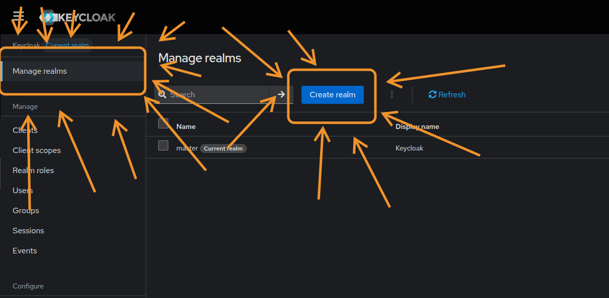

# Mind & Body

[](https://github.com/Datzu712/mind-body/actions/workflows/ci.yml)

Monorepo for the Mind & Body gym management platform, built with [Turborepo](https://turbo.build/repo) and [pnpm workspaces](https://pnpm.io/).

## Apps

_`mab` stands for Mind & Body btw_

| App              | Description                 | Stack                                                    |
| ---------------- | --------------------------- | -------------------------------------------------------- |
| `@mab/dashboard` | Admin dashboard desktop app | Next.js 16, Tauri 2, Tailwind, shadcn/ui                 |
| `@mab/mobile`    | Mobile app for gym members  | Expo 55, React Native 0.85, Expo Router                  |
| `@mab/restapi`   | Backend REST API            | NestJS, Fastify, Drizzle ORM, PostgreSQL, Pino, Keycloak |

## Requirements

- [Node.js](https://nodejs.org/) >= 22
- [pnpm](https://pnpm.io/) >= 11.X.X
- [Rust](https://rustup.rs/) >= 1.8X (for Tauri desktop builds)

## Getting started

```sh
pnpm install
```

## Development

Run all apps in parallel (at the moment only the dashboard with nextjs dev server):

```sh
pnpm dev
```

Run a specific app (you may want to use turbo for caching and parallelism):

```sh
pnpm --filter=@mab/dashboard dev
pnpm --filter=@mab/mobile start
pnpm --filter=@mab/restapi dev
```

### Local services (Docker)

The `docker/local/docker-compose.yml` file spins up the infrastructure needed for local development:

| Service    | Default port(s)            | Description                                                         |
| ---------- | -------------------------- | ------------------------------------------------------------------- |
| PostgreSQL | `5432`                     | Primary database                                                    |
| Redis      | `6379`                     | Cache                                                               |
| Keycloak   | `8080`                     | Identity & access management                                        |
| Mailpit    | `1025` (SMTP), `8025` (UI) | Local email catcher, inspect sent emails at `http://localhost:8025` |

```sh
docker compose -f docker/local/docker-compose.yml up -d
```

Copy `docker/local/.env.example` to `docker/local/.env` to override default ports and credentials.

> Note: Mailpit is optional because you can also use gmail or any other smtp server but be aware of timeouts and that stuff

### Keycloak setup

Ir a `http://localhost:8080` y loguearse con el usuario admin y pass admin (se pueden configurar en un docker/local/.env tambien pero es opcional).
Luego ir a "Manage Realms" -> "Add realm".



Luego simplemente hay que importar el JSON de la realm que se encuentra en `docker/local/kc-exports/mab-dev-realm.json` y listo, ya estaría configurado keycloak contra el SMTP de prueba, clientes, etc...

Nota: Los export de keycloak NO incluyen usuarios y client-credentials, por lo que se deben volver a crear los usuarios mano y verificar los secrets de los clientes antes de correr cualquier aplicación.

#### Flujos de autenticación

<!-- me dio pereza pensar en como explicarlo en ingles y ademas el traductor es mala idea en este caso -->

> todo: cambiar la explicación de los flujos a ingles

##### Mobile

La app mobile utiliza el flujo [Authorization Code](https://datatracker.ietf.org/doc/html/rfc6749) junto a PKCE. Este flujo lo inicia directamente la app mobile al redirigir al usuario a una webview manejada por [Expo](https://docs.expo.dev/guides/authentication/) en la cual mostrara el login federado de keycloak, y luego al meter sus credenciales y loguearse, keycloak lo redirigirá a una URL interna tipo `exp://--/callback` con un código de autorización que la app mobile intercambiará por un access token y refresh token para autenticar las requests a la API.

La app mobile usara ese access token para hacer todas las consultar a la REST api mediante el header `Authorization: Bearer <token>` y la API validará el token antes de ejecutar cualquier logica de negocios, ademas, si la API al validar el token contra keycloak este es invalido por cualquier razon, entonces esta responderá con un 401 y la app mobile debera refrescar el token o forzar al usuario a loguearse de nuevo (btw eso le llamamos "refresh reactivo").

> Nota: El cliente OAuth2 es publico debido a que una app mobile no tiene manera de almacenar secrets, entonces PKCE soluciona parte de ese problema en el flujo mencionado.

##### Admin Dashboard

El dashboard de administración es bastante parecido al mobile, pero en este caso SI tenemos un cliente oauth2 privado y es la restapi como tal, pues la idea es que esta sea la que se encargue de manejar la auth SOLO para el admin dashboard y asi ahorrarnos la necesidad de tener un BFF simplemente para manejar el flujo de autenticación del dashboard. Entonces el dashboard hará un redirect al usuario a una ruta tipo GET /auth/login por ejemplo, y esta creara la URL de autorización de keycloak con el cliente `admin-dashboard` y redirigirá al usuario a esa url con el callback configurado hacia si misma (`/auth/callback`), luego que el usuario meta sus credenciales y keycloak lo redirija de nuevo a `/auth/callback` con el código de autorización, la restapi hara el token exchange con keycloak y seteara en las cookies el access token y refresh token y redirigirá finalmente al usuario al dashboard otra vez.

> Nota: Teniendo en cuenta que localmente no hay un reverse proxy, entonces la cookie se setea con el `domain` del dashboard. Esto en prod no sera un problema porque habrá un nginx por detras...

##### Restapi

La restapi dentro de su flujo principal SOLO valida tokens que lleguen en las cookies o como fallback, en el header `Authorization: Bearer <token>`, esto es para poder autenticar tanto al dashboard como al mobile sin necesidad de tener dos flujos de autenticación distintos, y ademas, tener una API unificada para ambos clientes hace que el desarrollo y mantenimiento sea mas sencillo.

## Common tasks

```sh
pnpm lint          # ESLint across all apps
pnpm typecheck   # TypeScript check across all apps
pnpm format        # Prettier format
pnpm format:check  # Prettier check
pnpm build         # Build all apps
```

## Remote caching

Turborepo remote cache is configured via Vercel. Set `TURBO_TOKEN` and `TURBO_TEAM` in your environment or CI secrets to enable it.

```sh
pnpm exec turbo login
pnpm exec turbo link
```

## TODO

- [ ] Separating Tauri from Next in different apps
- [ ] Change nextj.js to vite + tanstack router/react router (because Next.js in this context is just vite with a LOT of overhead)
- [ ] Add CD for mobile (EAS)
