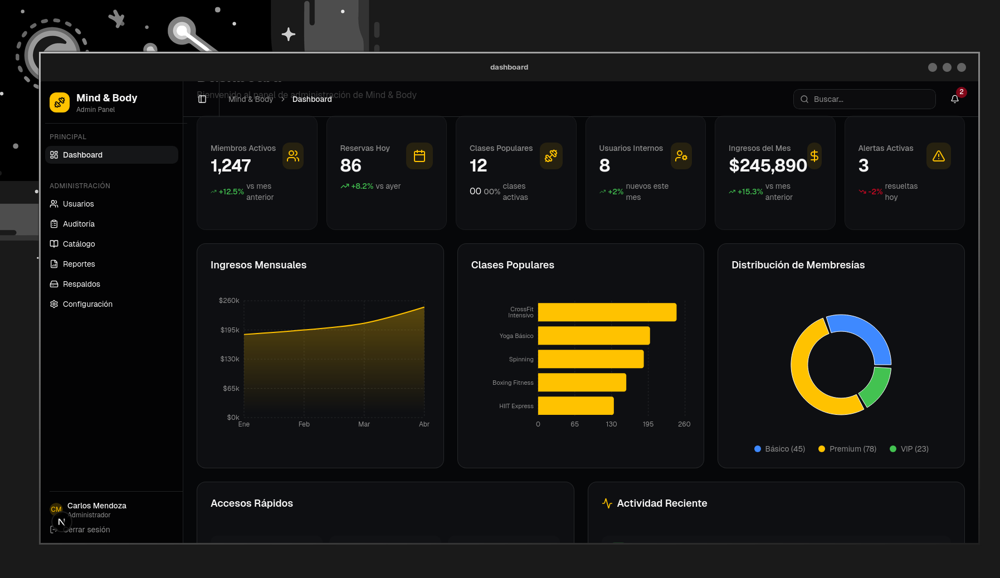

# Mind & Body Dashboard (prototype)



A gym and fitness center management desktop application built with Vite, TanStack Router and Tauri.

## Stack

- **Frontend:** Vite, React 19, TanStack Router, TypeScript
- **UI:** Tailwind CSS, Radix UI, Shadcn UI
- **Desktop:** Tauri 2.0 (Rust)

## Requirements

- [Node.js](https://nodejs.org/) >= 18
- [pnpm](https://pnpm.io/)
- [Rust](https://rustup.rs/) (for Tauri)

## Installation

```bash
pnpm install
```

## Development

Start the web server:

```bash
pnpm dev
```

Start the desktop app (Tauri):

```bash
pnpm tauri dev
```

## Build

```bash
pnpm tauri build
```

Outputs the desktop installer to `src-tauri/target/release/bundle/`.

## Project Structure

```
src/                # Frontend (Vite + TanStack Router)
  routes/           # Routes
  components/       # UI components
  features/         # Feature modules
  hooks/            # Custom hooks
  lib/              # Utilities
src-tauri/          # Desktop backend (Rust)
```
