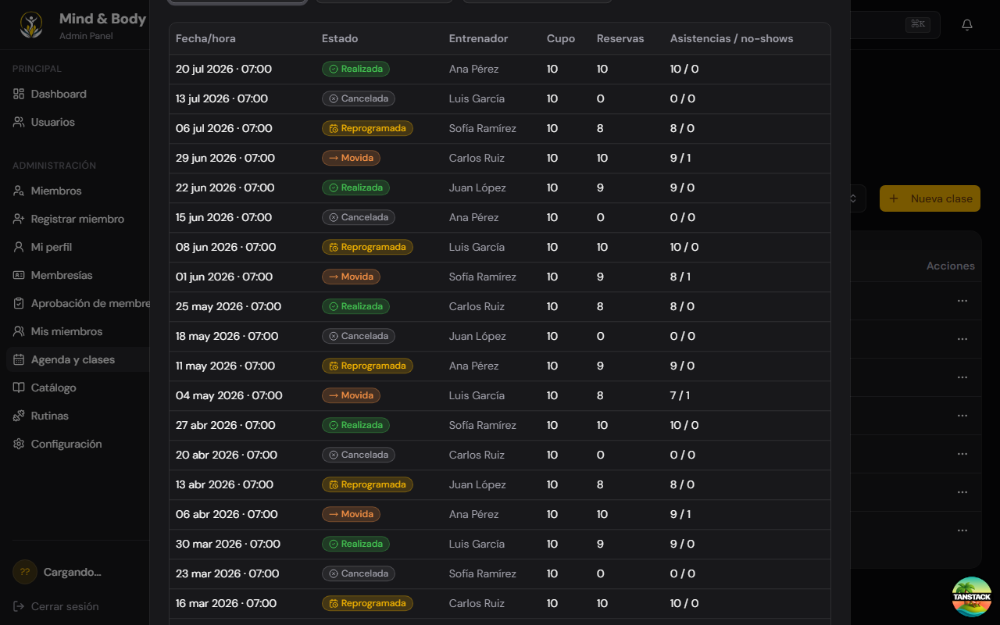
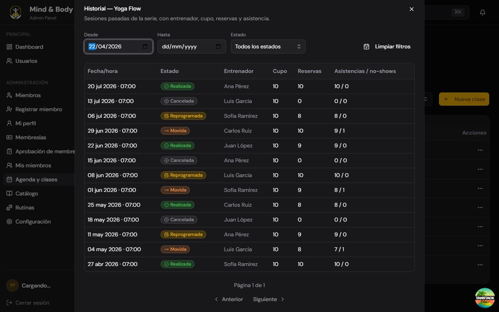

# Mind & Body Dashboard


A gym and fitness center management desktop application built with Vite, TanStack Router and Tauri.

## Stack

- **Frontend:** Vite, React 19, TanStack Router, TypeScript
- **UI:** Tailwind CSS, Radix UI, Shadcn UI
- **Desktop:** Tauri 2.0 (Rust)

## Requirements

- [Node.js](https://nodejs.org/) >= 18
- [pnpm](https://pnpm.io/)
- [Rust](https://rustup.rs/) (for Tauri)

## Installation

```bash
pnpm install
```

## Environment variables

Copy `.env.example` to `.env`:

```env
# Base URL of the REST API. The Vite dev server proxies `/api` to this target,
# so use your machine's LAN IP (not localhost) when testing from another device.
VITE_API_BASE_URL=http://localhost:3000
```

The dev server runs on a fixed port (`3000`, required by Tauri) and proxies
`/api` requests to `VITE_API_BASE_URL`.

## Development

Start the web server:

```bash
pnpm dev
```

Start the desktop app (Tauri):

```bash
pnpm tauri dev
```

## Build

```bash
pnpm tauri build
```

Outputs the desktop installer to `src-tauri/target/release/bundle/`.

## Project Structure

```
src/                # Frontend (Vite + TanStack Router)
  routes/           # Routes
  components/       # UI components
  features/         # Feature modules
  hooks/            # Custom hooks
  lib/              # Utilities
src-tauri/          # Desktop backend (Rust)
```

## Historial de sesiones por serie (Session Recap)

Resolved [issue #43](https://github.com/Datzu712/mind-body/issues/43): from the series table (tab "Gestión de clases y cupos" in `/dashboard/classes`), the 3-dot menu of each row now has **Ver historial** as the first option. It opens a modal with the past sessions of that series, filtered by date range and status, paginated 20 per page.







### What was done this session

1. **Issue read**: fetched issue #43 from GitHub via the REST API (requires a PAT with `repo` scope). The issue described the need for a per-series session history view in the class management dashboard.

2. **Spec creation**: interviewed requirements (modal vs tab, columns, filters, pagination). Refined the spec twice: first anchored to the codebase (mock data, Dialog not Sheet, 3 files), then graph-anchored via codebase-memory-mcp (name collisions with `routines/SessionStatus`, reuse of existing `@/components/ui/pagination`, prohibitions on `@tanstack/react-table` / `TablePaginationControls` / shared `EmptyState`). Spec at `specs/historial-sesiones-serie.md`.

3. **Codebase indexing**: indexed the repo in codebase-memory-mcp (3924 nodes, 8368 edges) to verify the spec against real code patterns and avoid hallucination.

4. **Build**: implemented 3 files per the spec:
    - `src/src/features/dashboard/classes/mock-classes.ts`: types `ClassSessionStatus` / `ClassSession`, labels, and a deterministic generator (12 weeks per class, 24 for `cls-1` to demo pagination > 20 rows).
    - `src/src/features/dashboard/classes/components/ClassHistoryDialog.tsx`: Dialog with date range + status filters, table with 6 columns, status badge, client-side pagination 20/page.
    - `src/src/features/dashboard/classes/components/ClassManagementTab.tsx`: added "Ver historial" as first dropdown item and rendered the dialog.

5. **Review loop**: `tsc --noEmit` EXIT=0, `eslint src/` clean except 47 pre-existing CRLF errors in `route.tsx` (unrelated to changes). Spec compliance verified against the refined spec.

6. **Ponytail review (self-scoring)**: scored against a 6-category rubric (spec compliance 25, conciseness 20, reuse 15, idiom 15, correctness 15, a11y 10 = 100). Found 2 findings: `trainerPool` alias (unnecessary indirection) and `hasAnyFilter` + `disabled` prop (unrequested disable polish). Initial score: 93.

7. **Rewrite loop**: removed the `useEffect` reset on open, collapsed `handleClear` to delegate to `resetPageAndApply`, trimmed the generator JSDoc to a 1-line `ponytail:` comment. Score: 98. Then removed the `trainerPool` alias and `hasAnyFilter`/`disabled` prop, fixed a Prettier format issue. Score: 99. Plateau: the remaining 1 point is empty-state icon, which the spec doesn't require (closing it would be spec creep).

8. **Hooks bug found and fixed**: during the screenshot pass, `ClassHistoryDialog` crashed with "Rendered more hooks than during the previous render". Root cause: `if (!item) return null;` was placed **before** the `useMemo`, so when `item` transitioned from `null` to a value the hook count changed and React aborted. Fix: moved the `useMemo` before the early return, added `if (!item) return [];` inside the memo, and changed `item.id` to `item?.id` in the deps array.

9. **Screenshots**: taken with the web-browser-agent (applied auth bypass → started `pnpm dev` on port 3000 → navigated to `/dashboard/classes` → switched to "Gestión de clases y cupos" tab → opened 3-dot menu on cls-1 Yoga Flow → clicked "Ver historial" → captured PNGs → closed browser). 4 PNGs in `apps/dashboard/docs/screenshots/`: 3 initial shots + 1 post-fix verification shot confirming the ponytail review fixes (removed `trainerPool` alias, removed `hasAnyFilter`/`disabled`, fixed Prettier format) didn't break the dialog.

10. **Auth bypass and revert**: the dashboard requires OIDC login against Keycloak (different origin: `:8080` vs dashboard `:3000`). The web-browser-agent's origin isolation blocks cross-origin navigation, so the OIDC redirect can't be completed. Bypass: temp 1-line patch in `apps/dashboard/src/routes/dashboard/route.tsx` replacing the `async beforeLoad` with `() => ({ user: { id: 'screenshot', email: 'screenshot@local', name: 'Screenshot' } as AuthUser })`. Reverted with `git checkout HEAD -- apps/dashboard/src/routes/dashboard/route.tsx`. The file is identical to HEAD (verified with `git diff` returning empty).

### Files changed

- `src/src/features/dashboard/classes/mock-classes.ts`: session history section with types and deterministic generator.
- `src/src/features/dashboard/classes/components/ClassHistoryDialog.tsx`: new dialog component with filters, table, badge, pagination.
- `src/src/features/dashboard/classes/components/ClassManagementTab.tsx`: added "Ver historial" dropdown item and dialog render.
- `apps/dashboard/README.md`: this section.
- `apps/dashboard/docs/screenshots/`: 4 PNGs (3 initial shots + 1 post-fix verification, taken by the web-browser-agent).

### Implementation notes

- Modal uses `Dialog` from `@/components/ui/dialog` (pattern from `ClassFormDialog`), not a Sheet: no Sheet component exists in this repo.
- Pagination reuses `@/components/ui/pagination` (`Pagination`, `PaginationPrevious text="Anterior"`, `PaginationNext text="Siguiente"`), no custom buttons, no `@tanstack/react-table`, no `TablePaginationControls`.
- Date inputs are native `<Input type="date">`, no date-picker library.
- Types use the `ClassSession*` prefix (`ClassSessionStatus`, `classSessionStatusLabels`, `ClassSessionStatusBadge`) to avoid collision with `SessionStatus` in `features/dashboard/routines/types.ts` and `sessionStatusLabels` in `routes/dashboard/routines/$id.tsx`.
- Mock data is deterministic (no `Math.random`): 12 weeks per class, 24 for `cls-1`. Dates computed with `date-fns` (`subWeeks` + `setDay`), only `date <= today` included. Cancelled sessions have 0 reservations / 0 attended / 0 no-shows. Trainer rotates over `MOCK_TRAINERS` and can differ from the series' assigned trainer.
- Empty states ("Sin sesiones en el historial" and "No se encontraron sesiones con los filtros aplicados.") use `TableCell colSpan`, mirroring `ClassManagementTab`.
- Invalid date range (`desde > hasta`) shows an inline error with `role="alert"` and does not apply the filter (table keeps previous result).
- Any filter change resets to page 1.
- The badge `ClassSessionStatusBadge` mirrors `ClassStatusBadge` exactly: config record keyed by status with `{ label, icon, className }`, `Badge variant="outline"`, `cn('gap-1 border font-medium', cls, className)`, icon `h-3.5 w-3.5 aria-hidden`.

### Verification

- `pnpm typecheck`: PASS (EXIT=0) in `apps/dashboard`.
- `pnpm lint`: PASS for the 3 feature files. The 47 pre-existing CRLF errors in `route.tsx` are unrelated: committed LF, Windows `core.autocrlf=true` converts to CRLF on checkout, Prettier rejects CRLF.
- Web-browser-agent verification: dialog opens without crashing (hooks fix works), all spec requirements render correctly (title, description, filters, 6 columns, data, badges, formats, past-only dates, cancelled→0/0/0, trainer rotation).
- Ponytail score: 99/100. Plateau at 1 point (empty-state icon), not addressable without spec creep.

### Spec

The spec that drove this implementation is at `specs/historial-sesiones-serie.md` (outside this monorepo, in the specs repo). A complete-session version covering this feature + README + screenshots + hooks bug fix is at `specs/historial-sesiones-serie-completa.md`.
