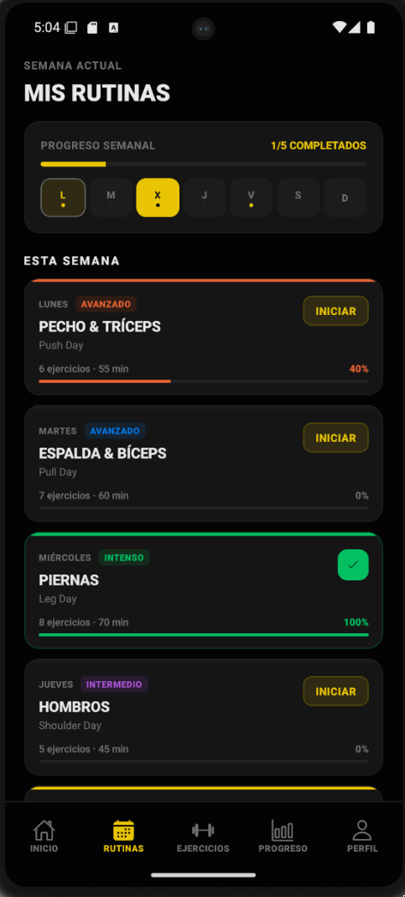

# Mind & Body Mobile (prototype)

<br>

<!-- Screenshot -->
<p align="center">
  
</p>

<br>

## About

This is the mobile application for Mind & Body, a platform for gym members to train, view their routines, track their progress, and manage their workouts...

## Requirements

- [Node.js](https://nodejs.org/) >= 22
- [pnpm](https://pnpm.io/) or [yarn](https://yarnpkg.com/) (imagine using npm in big 2026)
- [Expo Go](https://expo.dev/go) on your device, or an Android/iOS emulator
- [Adb](https://developer.android.com/studio/command-line/adb) (optional)

## Installation

```bash
pnpm install
```

## Usage

```bash
# Start the development server
pnpm start

# Android
pnpm run android

# iOS
pnpm run ios

# Web
pnpm run web
```

## Running locally

### Android Studio Emulator

First you need to install `adb` and set up an Android Virtual Device (AVD) in Android Studio. Then, start keycloak and reverse the port to allow the emulator to access it via localhost:

```bash
adb reverse tcp:8080 tcp:8080
```

Also you need to configure two `.env` files:

- docker/local/.env

```env
KEYCLOAK_HOSTNAME=localhost
```

Then you can start keycloak with `docker compose -f docker/local/docker-compose.yml up`.

- apps/mobile/.env

```env
EXPO_PUBLIC_KEYCLOAK_URL=http://localhost:8080
EXPO_PUBLIC_KEYCLOAK_REALM=mab
EXPO_PUBLIC_KEYCLOAK_CLIENT_ID=mobile
```

Then you can run the app with `pnpm --filter=@mab/mobile start` and it should connect to keycloak.

#### Installing the APK directly (Android)

Install the apk in your emulator via adb (this also works for physical devices connected via USB with debugging enabled):

```bash
adb devices
```

1. Install the APK:

```bash
adb install <your-apk-file>.apk
```

> If you have multiple devices connected, target a specific one with `adb -s <device-id> install ...`

### Running on a physical device (Expo Go)

To run the app on your physical device, you can use Expo Go. Make sure your device is connected to the same network as your development machine or use a USB connection (idk how it works so you might need to look it up).

First, config the `docker/local/.env` file to point to your machine's local IP address (you can find it with `ipconfig` or `ifconfig`):

```env
KEYCLOAK_HOSTNAME=192.168.x.x
```

Then, update the `apps/mobile/.env` file with the same IP address:

```env
EXPO_PUBLIC_KEYCLOAK_URL=http://192.168.x.x:8080
EXPO_PUBLIC_KEYCLOAK_REALM=mab
EXPO_PUBLIC_KEYCLOAK_CLIENT_ID=mobile
```

## Troubleshooting

ask claude bro

## Stack

- [Expo](https://expo.dev) ~55
- [React Native](https://reactnative.dev) 0.83
- [React](https://react.dev) 19
- [Expo Router](https://expo.github.io/router)
